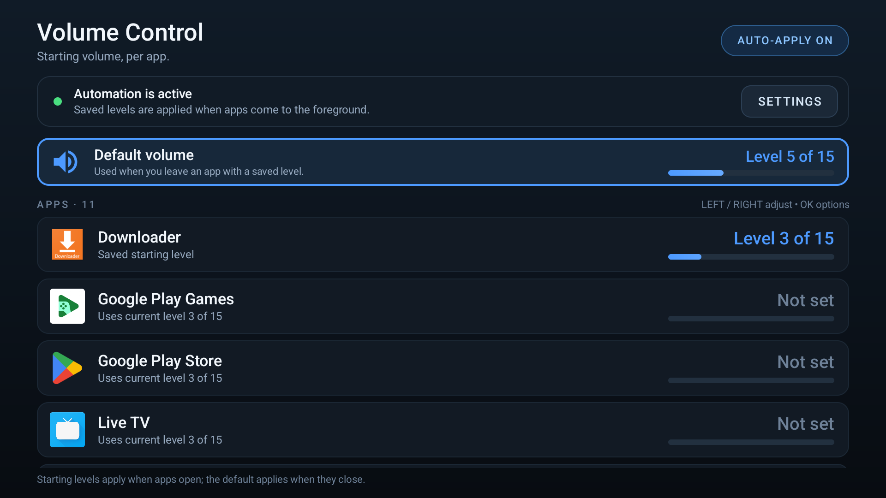

> Disclaimer: This project was made using an AI coding model. I am not a developer.

# Volume Control for Android TV

Assign a **starting media volume to each app**. When an app comes to the
foreground, Volume Control sets the TV's media output to the level you chose for it.

No root required. Everything is controlled with the TV remote.



```
Default volume         Level 5 of 15
Button Mapper          Level 5 of 15
Downloader             Level 6 of 15
Google Play Store      Level 4 of 15
MEO                        Not set
```

## Features

- Per-app starting volume, saved as a percentage (0???100) so rules keep their
  meaning on TVs with different numbers of volume steps. The UI shows the
  resulting TV level, e.g. `Level 6 of 15`.
- A **default volume** used whenever the foreground app has no rule of its own,
  so leaving an app with a saved level restores your preferred level.
- Live app-switch detection through an Android accessibility service.
- D-pad friendly UI: **LEFT / RIGHT** adjusts a row immediately, **OK** opens
  options.
- Quick actions in the options dialog: **MIN**, **???10**, **+10**, and **MAX**.
- **OPEN APP** launches the selected app and applies its level right away.
- **CLEAR** removes a rule; an app without a rule uses the default volume, or
  keeps the current volume when no default is set.
- Global **AUTO-APPLY ON/OFF** pause switch.
- Media stream only (`STREAM_MUSIC`); notifications, alarms, and system sounds
  are untouched.


## Install

The ready-to-sideload APK is:

```
dist/VolumeControl-1.0.0-release.apk
```

Install it with ADB:

```sh
adb install -r dist/VolumeControl-1.0.0-release.apk
```

or copy it to the TV and open it with a file manager / Downloader.

> If a **debug** build was previously installed, uninstall it first. Debug and
> release builds use different signing keys, so Android will refuse to update
> one over the other. Uninstalling also removes saved rules.

> This release uses the application ID `com.santodan.appvolume`. An older
> `com.danny.appvolume` install is treated as a separate app; uninstall it to
> avoid two Volume Control entries in the launcher. Its saved rules are not shared.

## First-time setup

1. Open **Volume Control** from the TV launcher.
2. Select **TURN ON** on the status card.
3. In Android's accessibility screen, open **Volume Control** and enable it.
4. Press **BACK** to return. The status card turns green
   (*Automation is active*) and focus moves to the app list.

The service must stay enabled for automation to work.

## Daily use

| Action | Result |
| --- | --- |
| **UP / DOWN** | Move between the default volume card and the app list |
| **LEFT / RIGHT** on the default card | Decrease/increase the default volume by one TV step |
| **LEFT / RIGHT** on an app row | Decrease/increase that app's starting volume by one TV step (saved immediately) |
| **OK** on the default card | Open the default volume dialog |
| **OK** on an app row | Open the options dialog |
| **BACK** | Close the dialog |

In the dialog:

- **??? / +** change the level one TV step at a time. The first adjustment starts
  from the current media volume if no level is saved yet.
- **MIN** jumps to level 0 and **MAX** jumps to the highest level.
- **???10 / +10** move ten TV steps at once (clamped to the 0???15 range).
- **OPEN APP** closes the dialog, launches the app, and applies its saved level.
  The default volume dialog has no **OPEN APP** action.
- **CLEAR** removes the saved level. The dialog switches to *Not set*.
- **DONE** closes the dialog.
- **AUTO-APPLY ON/OFF** (top right) pauses or resumes automation. While paused,
  saved rules are kept but nothing is applied.

Rows show the actual device level, e.g. `Level 4 of 15`. Apps without a rule
show *Not set* and *Uses current level N of M*. The default volume card works
the same way and sits above the app list.

The default volume applies to any foreground app that has no rule of its own ???
including the launcher. So when you leave an app with a saved level, the TV
returns to the default level. If no default is set, the volume is left alone.

## How it works

- An `AccessibilityService` listens for `TYPE_WINDOW_STATE_CHANGED` and
  `TYPE_WINDOWS_CHANGED` events and reads **only the foreground package name**.
  It never reads, captures, or stores screen content.
- `android` and `com.android.systemui` events are ignored so dismissing the
  system volume panel or power menu does not re-apply a level over a manual
  remote adjustment.
- Rules are stored in `SharedPreferences` as percentages
  (`app_volume_rules_v1`); the default level and the auto-apply switch are in
  `app_volume_settings_v1` (`default_percent`, `auto_apply`). Percentages keep
  the settings portable across TVs with different step counts.
- Applying a rule calls
  `AudioManager.setStreamVolume(STREAM_MUSIC, index, 0)` with no system UI.
- Percentages are converted with `round(percent / 100 ?? maxSteps)`. On a
  15-step TV, 27% maps to level 4 and 40% maps to level 6.
- When an app has no rule, the default level is applied instead. If the default
  is also unset, the current volume is left untouched.
- Volume is applied only when the foreground package changes. Manually changing
  the volume while an app is open is left alone until you switch apps again.

## Privacy

Volume Control declares only `MODIFY_AUDIO_SETTINGS` and uses the accessibility
service solely to learn the foreground package name. There is no network code,
no analytics, and no data leaves the device.

## Build from source

**Build requirements:** JDK 17+ (JDK 21 used here) and Android SDK with API 36
(`compileSdk 36`, `targetSdk 35`).

```powershell
$env:JAVA_HOME="E:\Morphe\jdk-21.0.2"
.\gradlew.bat assembleDebug     # debug APK
.\gradlew.bat assembleRelease   # signed release APK
```

Outputs:

```
app/build/outputs/apk/debug/app-debug.apk
app/build/outputs/apk/release/app-release.apk
```

### GitHub Actions builds

Push a commit with `[release]` anywhere in its message (for example,
`Fix volume switching [release]`) to build a signed release APK and publish
it automatically in the repository's **Releases**. If a push
contains several commits, a matching message in any of them triggers the build.
Other branch pushes show a skipped build job.

The release tag defaults to `v` followed by the app's `versionName` (currently
`v1.0.0`). Releasing the same version again updates the APK on that release;
increase `versionName` and `versionCode` in `app/build.gradle.kts` for a new
app version. Existing tags stay on their original commit.

Pushing a `v*` tag also builds and publishes a release using that tag. You can
start a release manually with **Run workflow**; its optional version input
sets the release tag and APK filename, without changing the app's internal version.
The APK is also available from **Actions → Build and Release → the run →
Artifacts → VolumeControl-APK**.

The repository must have these Actions secrets: `KEYSTORE_BASE64`,
`KEYSTORE_PASSWORD`, and `KEY_PASSWORD`. The optional `KEY_ALIAS` secret
overrides the default alias, `appvolume`. The workflow restores
the keystore to `keystore/appvolume-release.jks` and passes the signing
credentials to Gradle through environment variables.

### Local signing

Release signing is configured in `app/build.gradle.kts` and reads
`keystore.properties` from the project root:

```properties
storeFile=keystore/appvolume-release.jks
storePassword=...
keyAlias=appvolume
keyPassword=...
```

The keystore and `keystore.properties` are git-ignored. **Back up
`keystore/appvolume-release.jks` and its password** ??? you need the same key to
ship updates that install over this build.

Release certificate (SHA-256):
`DD:66:16:DA:F6:CC:B6:94:E9:BA:04:B7:9B:4C:8B:46:C9:00:6A:6B:AE:ED:5D:F6:FD:03:56:4E:EB:FC:1A:52`

## Test evidence (MiBox4, Android 9)

- Debug build installed and launched on the MiBox; signed release build installed
  and launched on the Android 16 emulator. Layout and D-pad focus verified
  through `uiautomator` dumps.
- Accessibility service enabled; status card switched to *Automation is
  active* and focus moved to the first row. The service was confirmed bound in
  `dumpsys accessibility`.
- Rules verified in `shared_prefs` and applied on app entry:
  - Downloader at 40% ??? `setStreamVolume(STREAM_MUSIC, 6)` (level 6 of 15).
  - Google Play Store at 27% ??? level 4 of 15.
  - Button Mapper at 33% ??? level 5 of 15.
- Default volume set to 33% (level 5 of 15); fallback verified end to end:
  Downloader ??? level 6, Home ??? default level 5, Play Store ??? level 4,
  Home ??? default level 5.
- Default volume dialog verified: `+10` 5???15, `MIN`???0, `MAX`???15, `???10`???5;
  no **OPEN APP** action is shown.
- `CLEAR` on the default card removed the fallback; leaving Downloader then
  kept level 6 unchanged.
- Paused mode (`AUTO-APPLY OFF`): opening Downloader left the volume at level 5.
- `CLEAR` removed only the Downloader rule; the row changed to *Not set* and the
  next launch left the volume unchanged.
- `OPEN APP` launched Downloader and applied 40% (level 6); after manually
  raising the volume to 9, re-entering Downloader restored level 6.
- Logcat tag `AppVolume` reports each apply, e.g.
  `Foreground=com.esaba.downloader, app=40%, applied=true` and
  `Foreground=com.klevico.monet, default=33%, applied=true`.
- Signed release APK installed cleanly on the Android 16 TV emulator;
  accessibility bound, Downloader set to 20%, and its launch applied level 3
  of 15. Release signature verified with `apksigner verify --print-certs`.

## Troubleshooting

- **Status card says "Automation is off"** ??? enable Volume Control under
  Settings ??? Accessibility. On Android 13+ sideloaded apps may also require
  *Allow restricted settings* in the app's system info page before the
  accessibility toggle becomes usable.
- **Automation stopped after reinstall / "force stop"** ??? Android disables an
  app's accessibility service when the app is force-stopped, reinstalled, or
  cleared from recents in some firmware. Re-enable it under Accessibility.
- **Volume changes but then jumps back** ??? another app or the TV firmware is
  also controlling media volume (e.g. a soundbar/HDMI-CEC volume sync). Disable
  the competing control.
- **Rules look different from the expected level** ??? some percentages round to
  the same TV step on a device with few steps. The dialog always shows the
  resulting `Level X of Y`.
- **Volume does not return to the default** ??? check that a default level is set
  on the card above the app list, and that the app you left does not have its
  own rule.

## Project layout

```
app/src/main/java/com/santodan/appvolume/
  MainActivity.kt                    TV UI, list, status, dialog wiring
  AppListAdapter.kt                  Rows, focus, LEFT/RIGHT handling
  AppVolumeDialog.kt                 Options dialog
  AppVolumeAccessibilityService.kt   Foreground detection + apply
  AudioLevels.kt                     Percent <-> step conversion, setStreamVolume
  VolumeRules.kt                     SharedPreferences rules / default / flags
  AppRepository.kt                   Launchable app query and launching
  AccessibilityStatus.kt             Service-enabled check
  VolumeBarView.kt                   Row level bar
app/src/main/res/                    Layouts, drawables, theme, strings
tools/generate-art.ps1               Launcher icon and TV banner generator
```

## Limitations

- Applies to the **media** stream only.
- Needs the accessibility service running; firmware that aggressively kills
  background apps may need the service re-enabled.
- Apps that manage their own internal audio (e.g. some players with in-app gain)
  may sound different even when the TV media level is correct.
- The level is applied on app switches, not reapplied continuously, so manual
  volume changes during a session are respected.
- Rules are keyed by package name; launcher apps that show other apps' content
  (e.g. a TV launcher's "continue watching" preview) cannot be distinguished.


## Architecture compatibility

This app uses standard Android APIs (AudioManager, AccessibilityService, Settings) with no native code or ABI-specific dependencies. It builds with ndroid {} defaults and should run on common Android TV/Android architectures (armeabi-v7a, arm64-v8a, x86, x86_64) as long as the device supports Leanback/TV features or a standard Android UI.
